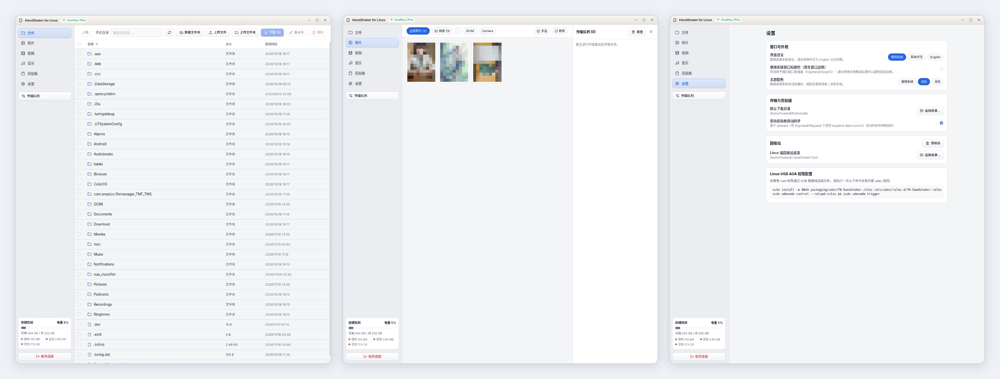

# HandShaker for Linux

开源的 **Smartisan HandShaker** Linux 桌面端套件，提供图形桌面应用（`handshaker-desktop`）、命令行工具（`hs-cli`）与实验性 FUSE 挂载工具（`handshaker-mount`），支持通过 **Wi-Fi（mDNS `_handshaker_ssp._tcp`）** 和 **USB AOA** 连接管理运行 HandShaker APK 的 Android 手机。

> [!NOTE]
> **Clean-room 声明**：本仓库不包含任何锤子科技（Smartisan）官方专有图片、图标或音频资源，与原厂无官方关联，仅用于个人学习、兼容性研究与非商业用途。拥有官方 macOS / Windows 安装包的用户可通过 [`tools/extract_assets.py`](tools/extract_assets.py) 在本地提取原版视觉与音效资源。

## 界面预览



---

## 关于本项目

### 项目简介

锤子科技官方曾推出过 macOS 与 Windows 版 HandShaker，但从未提供 Linux 原生客户端。本项目采用 **协议级 Clean-room 重实现** 路线，基于 **Tauri v2 + Rust + React 18 + TypeScript** 在 Linux 端完整重写 SmartSync 协议与桌面界面：手机端无需任何改动，即可直接配合社区维护版 Android APK 使用（协议细节见 [`docs/PROTOCOL_NOTES.md`](docs/PROTOCOL_NOTES.md)）。

### 基于以下项目开发

- [**rianlu/handshaker-android-maintained**](https://github.com/rianlu/handshaker-android-maintained) — 面向现代 Android（Android 13–16）的非官方维护版（手机端直连兼容目标）
- [**rianlu/handshaker-mac-maintained**](https://github.com/rianlu/handshaker-mac-maintained) — macOS 维护版（协议符号与交互逻辑参考）
- [**rianlu/handshaker-windows-maintained**](https://github.com/rianlu/handshaker-windows-maintained) — Windows 维护版（帧格式、数据结构与界面布局参考）

### 致谢

- **锤子科技（Smartisan）及原 HandShaker 团队**：打造了经典的 HandShaker 跨设备文件与媒体管理体验。
- **UP 主「禄眠」（[@rianlu](https://github.com/rianlu)）**：持续维护 Android / macOS / Windows 三端维护版，修复现代 Android 权限、媒体查询、USB Accessory 授权与剪贴板兼容问题，为本项目的协议逆向与真机验证提供了关键基础。
- **开源社区**：感谢 Tauri、Rust 生态（`tokio`、`prost`、`rusb`、`mdns-sd`、`fuser`、`arboard`）、React 以及 [LINUX DO](https://linux.do/) 社区。

---

## Linux 版新增与修复的功能

### 1. Linux 本地回收站与多设备安全恢复

- **解决非锤子手机“移至回收站”实际直接删文件的问题**：原版 Android 端仅在 `ro.product.brand == "smartisan"` 时移入系统相册回收站，其余 Android 手机均会直接物理删除。
- **Linux 端回收站（默认 `~/.HandShakerTrash`）**：桌面端将回收站落地到 Linux 本地目录（按 XDG Trash 结构分为 `files/` 与 `info/`）。选择“移至回收站”时，先将手机文件/目录完整下载到暂存区并写入 `.trashinfo` 元数据，确认落盘后再删除手机原文件；任一步失败立即回滚，保证数据零丢失。
- **来源手机元数据与防误恢复校验**：`.trashinfo` 会额外记录 `X-HandShaker-Device-UUID`、`X-HandShaker-Device-Name` 与 `X-HandShaker-Device-Model`。执行恢复前会校验当前连接的手机是否与删除时一致，防止将 A 手机的文件误恢复到 B 手机。
- **独立设置模块与管理页面**：
  - **设置 -> 回收站**：支持通过原生目录选择器自定义 Linux 回收站目录（自动拦截 `/`、`/home`、`..` 等危险路径），并提供 **回收站** 入口按钮；
  - **回收站页面**（[`TrashView.tsx`](src/components/TrashView.tsx)）：无需连接手机即可浏览与筛选已删除项目，查看手机原路径与来源设备标识，支持一键恢复到手机原路径（需连接原设备）、二次确认彻底删除与清空回收站。

### 2. 照片、视频与音乐增强

- **照片「相册模式」**：在照片页新增 **相册** 视图，按文件夹聚合展示封面、路径与照片数量，支持点击进入具体相册浏览。
- **媒体页拖拽直接上传**：除文件页外，照片、视频、音乐三页面也支持直接拖入本地文件或文件夹上传，默认分别写入手机 `/storage/emulated/0/DCIM`（若已打开某相册则直接传至该相册目录）、`Movies` 和 `Music`。
- **多选批量操作**：照片、视频、音乐三页面均新增 **多选** 模式与批量操作栏，支持全选、下载、**复制到指定本地目录** 及批量删除。
- **单张预览与删除确认**：照片 QuickLook 预览（空格开关、左右键切换）新增显示手机完整路径与快捷删除按钮；所有删除动作均配有二次确认弹窗。

### 3. Wi-Fi 多设备智能识别

- 针对 Android 端 mDNS 服务名固定为 `handshaker_ssp_` 且无 TXT 属性导致多台手机重名难区分的问题，扫描时并发执行 **无感 `Handshake 01` 探测**（600ms 超时、不发送 `Handshake 02`，**不会触发手机端授权弹窗**），并结合本地设备档案缓存（`device_profiles.json`）与 USB 描述符匹配，直接在欢迎页展示 **设备名称、厂商型号、版本** 及 **已配对 / 已锁屏** 状态。

### 4. 多语言支持与桌面稳定性修复

- **双语界面**：内置 **简体中文** 与 **English**，支持跟随系统自动切换或手动指定。
- **修复拖拽重复任务**：修复 React `<StrictMode>` 与页面切换下 `onDragDropEvent` 异步注销竞态，结合后端队列幂等去重，避免单次拖拽生成多个相同传输任务。
- **修复音视频播放与崩溃问题**：启动时检测 GStreamer 插件，缺少组件时避免挂载 `<audio>`/`<video>` 导致 `WebKitWebProcess` 崩溃，改为提示使用系统播放器打开或下载；同时为 Linux 注册渲染进程崩溃自动重载恢复；优化调用 `mpv` 播放音乐时强制弹出图形窗口与控制条。
- **Wayland / Hyprland 与安全适配**：自动识别 Hyprland / Sway / i3 / River / Niri 等平铺式 WM 切换无边框标题栏；基于 `arboard`（`wayland-data-control`）实现 Wayland / X11 双向剪贴板防回环同步；启动脚本自动为 NVIDIA 显卡禁用 WebKit DMABUF；本地 HTTP 媒体桥接启用随机 Token 鉴权，下载路径与上传符号链接均有安全边界校验。

---

## 项目结构

- **`crates/handshaker-proto`** — Clean-room Rust 协议核心库（RSA-1024 / AES-256-CBC / RSA-SHA256 握手与 PBKDF2 信任存储、多路复用帧编解码、Protobuf RPC、Wi-Fi mDNS 发现与探测、USB AOA 传输）及 `hs-cli`
- **`src-tauri`** — Tauri v2 桌面后端（`handshaker-desktop`），负责会话管理、传输队列、本地 HTTP 媒体/缩略图桥接、Wayland/X11 剪贴板同步与 Linux 回收站
- **`src/`** — React 18 + TypeScript + Zustand 前端界面
- **`crates/handshaker-fuse`** — 基于 `fuser` / `fuse3` 的 FUSE 虚拟文件系统（`handshaker-mount`）

---

## 快速开始

### 1. 安装依赖（Arch Linux）

```bash
sudo pacman -S --needed webkit2gtk-4.1 gtk3 gst-plugins-good gst-libav libusb fuse3 hicolor-icon-theme base-devel nodejs pnpm rust
```

### 2. 配置 USB AOA 权限（可选，用于 USB 有线连接）

```bash
sudo install -m 0644 packaging/udev/70-handshaker.rules /etc/udev/rules.d/70-handshaker.rules
sudo udevadm control --reload-rules && sudo udevadm trigger
```

重载规则后重新插拔一次手机数据线。Android 16 / OriginOS 注意事项见 [`packaging/udev/README.md`](packaging/udev/README.md)。

### 3. 构建与运行

```bash
# 安装前端依赖并启动开发版桌面应用
pnpm install
pnpm tauri dev

# 构建 Release 二进制文件（desktop、hs-cli、handshaker-mount）
pnpm run build
cargo build --release --workspace

# 运行全套检查与测试
cargo clippy --workspace --all-targets -- -D warnings
cargo test --workspace
pnpm run typecheck && pnpm run test && pnpm run build
```

---

## CLI 与 FUSE 挂载

```bash
# 发现设备 / 连接查看信息（Wi-Fi 或 USB AOA）
cargo run -p handshaker-proto --bin hs-cli -- discover
cargo run -p handshaker-proto --bin hs-cli -- info
cargo run -p handshaker-proto --bin hs-cli -- --usb --allow-usb-switch ls /storage/emulated/0

# FUSE 挂载手机存储到 ~/Phone（Ctrl+C 或 fusermount3 -u ~/Phone 卸载）
mkdir -p ~/Phone
cargo run -p handshaker-fuse -- ~/Phone --host <PHONE_IP> --port 44289
cargo run -p handshaker-fuse -- ~/Phone --usb --allow-usb-switch
```

---

## 补充说明（Wayland / 资源提取 / 打包）

- **Wayland / NVIDIA**：原生 Wayland `initialClass` 为 `handshaker-desktop`（对应 [`handshaker-linux.desktop`](packaging/handshaker-linux.desktop)）；启动脚本 [`handshaker-linux.sh`](packaging/handshaker-linux.sh) 会在检测到 NVIDIA 驱动时自动导出 `WEBKIT_DISABLE_DMABUF_RENDERER=1`。
- **可选资源提取**：若本地拥有官方安装包，可运行 `python3 tools/extract_assets.py /path/to/HandShaker.dmg --install-icon` 将图标与音效提取至 `$XDG_DATA_HOME/handshaker-linux/assets/`。
- **Linux 打包**：Arch Linux 打包见 [`packaging/arch/PKGBUILD`](packaging/arch/PKGBUILD)；AppImage 打包可运行 [`packaging/build-appimage.sh`](packaging/build-appimage.sh)。
