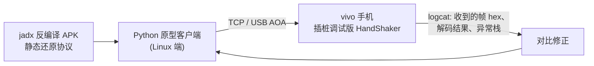
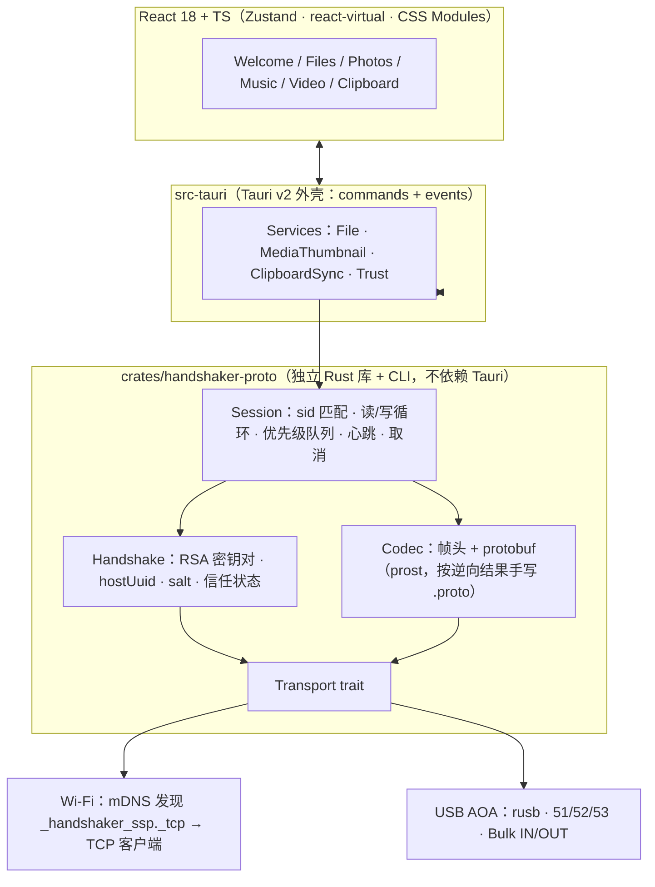

# HandShaker for Linux 实施方案 v2

> 这一版按审查报告重写，并针对两个实际限制做了调整：**没有 Windows/Mac 环境（抓不到原版客户端的流量）**，测试手机是 **vivo X200 Pro Mini（Android 16 / OriginOS）**。
>
> 技术栈保持不变：**Tauri v2 + Rust + React 18 + TypeScript + Vite**。

---

## 0. 本轮新确认的事实（来自源码抽查）

| 结论 | 证据 | 对方案的影响 |
| :--- | :--- | :--- |
| 手机是 **Wi-Fi 服务端** | `NsdManager.registerService("_handshaker_ssp._tcp.")`，`new ServerSocket(port)`（`aoa/service/m.smali`、`aoa/service/i.smali`） | 桌面端是客户端：先用 mDNS 发现手机，再主动连过去 |
| **RSA 公钥由桌面端提供** | `decoder/b.a([B / a$ca)` 从桌面发来的 UTF-8 文本里解析出模数和指数，构造 `RSAPublicKeySpec`；手机用这个公钥加密 `"ok"` 后发回（`aoa/g/j.smali` 里的 `writeKeyExchangeInfo`） | **桌面端可以自己生成 RSA 密钥对**，不依赖原厂私钥。这是之前最大的可行性风险，现在已基本排除 |
| 握手里有 `hostUuid`、`salt` 字段 | `aoa/g/j.smali:2373-2404` | 桌面端需要一个稳定持久的主机 UUID，和信任/配对状态对应 |
| 消息类大部分保留了结构 | `com/smartisanos/smartfolder/a/a$xx`（protobuf-lite 生成类，字段名被混淆） | 可以从 `writeTo`/`parseFrom` 里还原字段编号和类型 |
| 手机端 targetSdk = 34 | `apktool.yml` | Android 16 的“本地网络权限”目前不会拦截它 |
| 原版 Windows 程序集加了壳 | `Communicator.dll` 里有混淆名和 AES 解密桩 | 以 **Android 端为主要逆向对象**，Mac 端的符号表作为命名参照 |

---

## 1. 没有原版客户端时，怎么验证协议：把手机当“裁判”



1. **静态分析**：用 jadx 把 `handshaker_130128.apk` 反编译成 Java，顺着手机端（服务端）的代码读：accept 循环 → 帧读取 → 解码分发 → 每类请求的处理函数。
2. **插桩调试版 APK**：维护仓库本身就是 apktool 工程。我们在它的输入/输出流（参考现有的 `UsbDiagnosticInputStream`/`OutputStream`）和解码入口里，加上“帧头 + 前 N 字节 hex”的 logcat 输出，重新打包、签名后装到手机上。
   - 手机能直接告诉我们：它收到了什么、解析到哪一步、在哪里抛了异常。这比原版流量更有用，因为能看到服务端内部状态。
   - 这个调试版**只用于开发**，不分发；不写入文件或剪贴板的内容，只记录长度和帧头。
3. **迭代**：Python 客户端发一帧 → 看 logcat → 修正，直到握手、列目录、拉缩略图都跑通。
4. **兜底（可选）**：如果某一步怎么都卡住，可以在 Linux 上用 QEMU/KVM 跑一个微软官方免费的 Windows 评估版虚拟机，直通 USB/桥接网络来抓原版流量（需要大约 60 GB 磁盘和半天配置）。**不作为前置条件**。

---

## 2. 架构（修正后）



**关键改动：**
- 协议层拆成独立 crate `handshaker-proto`，自带 `hs-cli`（`discover` / `connect` / `ls` / `pull` / `push`），可以脱离 UI 单独开发和测试，后面做 FUSE 也能直接复用。
- Wi-Fi 改成 **mDNS 发现 + 主动连接**。二维码只有在逆向确认存在“手机反向连接桌面”的流程后才会做（`h/d.smali` 里有出站 Socket，待确认）。
- 新增 **Trust 模块**：本地持久化 RSA 私钥、`hostUuid`、已信任设备列表，存放在 `~/.local/share/handshaker-linux/`，权限 0600。

---

## 3. 工程目录

```text
Handshaker_for_Linux/
├── docs/                      # PROJECT_MEMORY / IMPLEMENTATION_PLAN / PROTOCOL_NOTES（逆向记录，逐条标注“已验证/推测”）
├── re/                        # 逆向工作区（.gitignore，不进仓库）：jadx 输出、插桩 APK 工程
├── tools/
│   ├── proto_probe.py         # M0 的 Python 原型客户端
│   └── extract_assets.py      # 运行时从用户本地官方安装包提取原版贴图
├── crates/handshaker-proto/   # 协议库 + hs-cli
│   ├── proto/handshaker.proto # 手写还原，每个字段注明来源类/偏移
│   └── tests/fixtures/        # 从 logcat 采集的真实帧，用作回归测试
├── src-tauri/                 # Tauri 外壳与服务层
├── src/                       # React 前端（只放自绘的占位资源）
└── packaging/udev/            # 70-handshaker.rules
```

---

## 4. 里程碑与放行条件

| 阶段 | 内容 | 放行条件（全部满足才进入下一阶段） |
| :--- | :--- | :--- |
| **M0 协议验证**（Go/No-Go） | jadx 静态分析；制作插桩调试版 APK；用 `proto_probe.py` 通过 **Wi-Fi** 连接手机 | ① 完成 01/02 握手，手机端显示已连接 ② 拿到 `GetDeviceInfo` 数据 ③ 列出根目录 ④ 帧格式写进 `PROTOCOL_NOTES.md`，并标注已验证 |
| **M1 协议库** | 把 M0 的成果迁移到 `handshaker-proto`（Rust），加上 fixture 测试和 `hs-cli` | `hs-cli ls /`、`pull`、`push` 在真机上都能跑通；单元测试覆盖握手和帧编解码 |
| **M2 USB AOA** | vivo 设备（VID `0x2d95`）的 AOA 切换；Bulk 端点接入同一个 Session | 插上线后 `hs-cli` 走 USB 能列目录；切换过程不需要 root，也不需要开 ADB |
| **M3 Tauri 外壳 + 核心界面** | 连接页、文件浏览、传输队列；先在 Hyprland 上做冒烟测试 | 文件浏览、上传、下载、重命名、删除闭环；Hyprland 下窗口行为正常 |
| **M4 媒体与剪贴板** | 相册时间线和缩略图缓存、音乐（含逆向确认手机端的音频 HTTP 服务）、视频、双向剪贴板 | 大相册滚动流畅；Wayland 剪贴板双向同步 |
| **M5 拟物 UI 复刻与发布** | 运行时提取原版贴图并换肤；AppImage/Flatpak；FUSE 挂载（可选） | 安装包里不带任何原厂资源；首次运行能从用户提供的官方安装包提取资源 |

**M0 不通过的处理**：先上 QEMU Windows 虚拟机抓原版流量；还是不通，就重新评估整个项目，不进入 UI 开发。
**为什么 M0 先走 Wi-Fi**：调试时手机要一直插着 USB 开 ADB 看 logcat，USB 口被占用；Wi-Fi 通道正好可以和 logcat 同时用。

---

## 5. vivo X200 Pro Mini / Android 16 / OriginOS 适配清单

| 项目 | 处理 |
| :--- | :--- |
| 开发期 ADB | 需要在开发者选项里打开“USB 调试”（只在开发期需要，最终用户不需要） |
| 安装插桩版 APK | 签名和维护版不同，**要先卸载已装的维护版**（会清空它的数据） |
| 后台保活 | OriginOS 杀后台比较激进：要允许 HandShaker 自启动、关掉电池优化、在“后台高耗电”里放行 |
| 存储权限 | 要授予“所有文件访问权限”（`MANAGE_EXTERNAL_STORAGE`） |
| AOA 切换 | 切换前设备是 vivo `2d95:xxxx`，切换后是 `18d1:2d00/2d01`；M2 第一步先用 `lsusb` 和请求 51 确认手机支持 AOA |
| 本地网络 | targetSdk 34，Android 16 不强制本地网络权限；Linux 端要放行 mDNS（UDP 5353 入站） |

**udev 规则（M2）**：对 vivo 原始 VID 和 AOA 的 `18d1:2d0[0-3]` 使用 `TAG+="uaccess"`，只给当前登录用户授权，不用 `0666`。不全局禁止 MTP，只在程序切换 AOA 时临时 detach 内核驱动。

---

## 6. 技术选型修正

| 项目 | v1 | v2 |
| :--- | :--- | :--- |
| 剪贴板 | arboard + wl-clipboard-rs | 只用 **arboard（开启 `wayland-data-control`）**；Hyprland 支持后台监听，GNOME 退回到窗口获得焦点时同步 |
| 标题栏 | 强制 `decorations:false` | 可配置；平铺式 WM 下默认用系统装饰或者不显示 |
| mDNS | mdns-sd（作为广播方） | mdns-sd（**作为浏览方**） |
| RSA | 未涉及 | `rsa` crate：生成 2048 位密钥对，PKCS#1 v1.5 解密，按手机端解析格式导出公钥文本 |
| UI 尺寸和色号 | 示例值 | M5 从 nib/XAML 里实际提取，之前的数值作废 |

---

## 7. 风险登记

| 风险 | 概率 | 应对 |
| :--- | :--- | :--- |
| 握手还有其他校验（签名、salt 算法） | 中 | 插桩 logcat 定位；兜底用 QEMU 抓包 |
| 帧格式 Wi-Fi 和 USB 不一致 | 中 | Transport 层留出适配钩子；M2 单独验证 |
| OriginOS 杀后台导致连接中断 | 高 | 文档引导用户放行；Session 支持自动重连 |
| vivo 不支持或限制 AOA | 低到中 | M2 第一步就验证；不行就只保留 Wi-Fi |
| 版权投诉 | 中 | 仓库和安装包不带原厂资源和名称（项目改名，比如 “Shaker for Linux”），资源在运行时提取 |
| WebKitGTK 在 Wayland 下渲染问题 | 中 | M3 一开始就做冒烟测试；必要时设置 `WEBKIT_DISABLE_DMABUF_RENDERER=1` |

---

## 8. M0 第一周具体任务

1. 安装 jadx 和 apktool（用户目录或 mise，不污染系统），反编译 APK 到 `re/`。
2. 读懂 `aoa/service/i`（accept 循环）、`aoa/decoder/*`（帧解码）、`aoa/g/j`（握手），产出 `PROTOCOL_NOTES.md` 初稿。
3. 在维护仓库的副本里加入 hex 日志插桩，`apktool b` 打包并签名，通过 ADB 装到 vivo 上。
4. 写 `proto_probe.py`：mDNS 发现 → TCP 连接 → 发送 HandshakeRequest01 → 对照 logcat 迭代。
